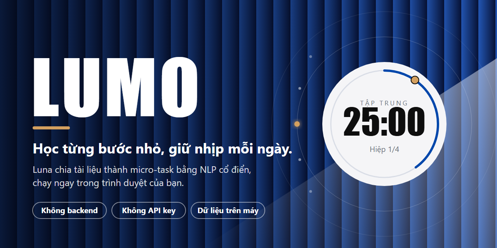

# Lumo



**Lumo** is a study planner that turns your own materials into short, paced tasks. Paste a note or upload a PDF, and **Luna**, the planning engine, splits it into modules and 2–5 minute tasks. Lumo then paces your day with Pomodoro blocks, spaced-repetition review and a "next task" ranking.

**Live demo:** https://lumo-chaugiahoa.vercel.app

Everything runs in your browser. There is **no backend, no account, no API key and no LLM**. Your data stays on your device.

> Luna is classic NLP (TF-IDF, cosine similarity, TextRank, heuristics). It is not a large language model, calls no external API and does not learn from the user.

## Try it in one minute

1. Open the demo and go to **Library**. Add a sample document (labelled "Sample document") or paste your own note.
2. Create a course from it. Luna shows the modules and tasks, and you can edit the result by hand.
3. Open **Next Up**, start a task, and finish three. Progress and the estimated finish date update from your actual pace.
4. Open **Review** to practise the auto-generated cards.

Data lives in IndexedDB, so it is empty on your first visit and is lost if you clear browser data. Use **Settings → Data → Export backup** to keep a copy.

## What it does

- **Library:** notes, links (http/https only), PDFs (stored as Blob, up to 20 MB), tags and filters.
- **Luna splitter:** structured mode (one module per chapter, appendices optional) and a topic-boundary mode (TextTiling-style, TF-IDF + cosine). Key sentences by TextRank, keywords by TF-IDF. Every task stores a "reason" so the choice can be explained.
- **Goal-based study:** type a goal and Luna scores each module by word overlap. Three modes: skim, core, full. Skipped tasks can be restored.
- **Next Up:** ranks tasks by proximity to the next milestone (0.35), forgetting from SM-2 (0.30), fit to the time left (0.20) and variety (0.15). These weights are a heuristic and have **not** been tuned on data.
- **Pomodoro:** pick how long you want to study today (10 minutes up to 8 h 55 min). The suggested split (25 min blocks, 5 min short break, 15 min long break after 4 blocks) follows the common Pomodoro convention and can be edited. Warning sounds at 10 s and the last 5 s.
- **Review:** SM-2 spaced repetition with four auto-generated question types.
- **Motivation, with limits:** XP and levels, streak with rest days, badges, and a soft session cap with a "good stopping point". No loot boxes, no push notifications.
- **Generated sound:** lofi and ambient tracks synthesised with the Web Audio API (no audio files). The "cafe" sound is a simulation.
- **Overview:** weekly stats from your own completed tasks, today's tasks and a calendar.
- **Backup:** export and restore all data as one JSON file (restore replaces existing data).
- **Languages:** Vietnamese and English. Only Settings, the navigation and Overview are translated so far.

## Measurements (with conditions)

- **Speed:** the splitter processed 8,292 Vietnamese/English words in 39–98 ms depending on mode (5 runs each). A concatenated ~30-page text (31,770 words) took 284 ms in one test. Both were measured in **Node/Vitest, not in a browser**; browser timings may differ.
- **Tests:** 130 passing, 1 todo.
- **Keyword quality:** judged by eye on 2 documents (one written sample, one real document). There is no ground truth, so **no accuracy figure is reported**.

## Known limitations

- Luna matches goals by words, not meaning. A Vietnamese goal against an English book will not match.
- Vietnamese keywords: compounds that appear only once fall back to single syllables, so some keywords are fragments (for example "khai", "tinh"). Generic words can also appear as keywords.
- Review cards built from fragment keywords are weaker, and distractor options are often single syllables, which can make the right answer stand out.
- Scanned PDFs without a text layer are not supported (no OCR). Links are saved but not split into tasks.
- `.txt` files must be UTF-8; the app does not warn about other encodings.
- Data is stored only in the browser. Clearing site data erases it.
- Mobile layout is not fully tuned. On narrow screens the "study for how long" wheel is not available.
- An Insights page with real usage metrics is not built yet.

## Tech

Next.js 16 (App Router, static export), TypeScript, Tailwind CSS v4, Dexie (IndexedDB), Vitest. Hosted on the Vercel Hobby plan. No analytics.

```bash
npm install
npm run dev     # http://localhost:3000
npm test
npm run build
```

## Credits

Some UI interactions are adapted from the [Lucian UX/UI Prompt](https://lucianlabs.dev/uxui-prompt/) gallery (MIT, © 2026 Seokwoooo): the rolling drum picker (#362), the language switch (#267) and the cursor-magnified dock (#208). Sample documents were written for this project.

Built by Châu Gia Hòa.